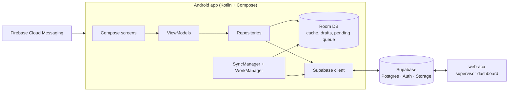

# AppACA: Offline-first forklift inspection app (Android)

Android app that digitizes daily forklift inspections at **TULSA S.A.** Operators identify a forklift by scanning its QR code, complete a configurable checklist with photo evidence, and log hour-meter readings, even without connectivity. Data syncs to Supabase in the background and feeds a real-time supervisor dashboard ([web-aca](https://github.com/andrynho10/web-aca)).

> Built during my professional internship (Sep–Nov 2025) as the **sole developer and project lead**. The system was a working pilot and did not reach production.

## Problem

Forklift inspections were a manual process. Supervisors needed a consolidated, up-to-date view of which machines had failures, the evidence behind each finding, and how many hours each forklift was being used. The app also had to keep working on the warehouse floor when connectivity drops.

## Solution

A native Android app designed **offline-first**: every flow works without a network, data is cached locally in Room, and a WorkManager-based sync layer pushes pending reports, photos and hour-meter records to Supabase as soon as connectivity returns. Supervisors manage assets and checklist templates from the same app and see results live in the web dashboard.

## Key features

- **QR asset lookup:** scan a forklift's QR code to open its record and inspection flow (ZXing).
- **Configurable checklists:** templates per forklift type, created and edited in-app by supervisors (categories, ordering, activation).
- **Evidence capture:** OK/Fail answers with mandatory comments and photos for failures; images are compressed before upload.
- **Drafts and compliance score:** inspections auto-save as drafts; the compliance score and inspection duration are computed as you go.
- **Hour-meter tracking:** start/close readings per shift, automatic usage hours, and a list of readings pending closure with reminders.
- **Role-based access:** Operator and Supervisor roles via Supabase Auth; supervisor panel and full asset/template CRUD.
- **Offline-first sync:** local cache, pending-report queue, connectivity-triggered and periodic sync with retries, and a visible sync-status indicator.
- **Push notifications:** Firebase Cloud Messaging with automatic token registration.

## Tech stack

| Layer | Technologies |
|---|---|
| Language & UI | Kotlin 2.0, Jetpack Compose, Material 3, Navigation Compose |
| Architecture | MVVM + Repository pattern |
| Local data | Room (SQLite) for cache, drafts and the pending-sync queue |
| Background work | WorkManager (periodic + connectivity-triggered sync) |
| Backend | Supabase (PostgreSQL, Auth, Storage) via supabase-kt, Ktor Client, Kotlinx Serialization |
| Device features | ZXing (QR), camera photo capture, Coil, Accompanist Permissions |
| Notifications | Firebase Cloud Messaging |

## Architecture



- **UI** never talks to the network directly: ViewModels go through repositories, which decide between the local Room cache and Supabase.
- **Writes are local first.** Reports go to a pending queue in Room; `SyncWorker` uploads them when the device is online (periodic job plus an immediate one-off job when connectivity is restored).
- **Same backend as the web dashboard**, so supervisors see new inspections without any extra integration.

<!-- SCREENSHOTS (pendiente: descomentar cuando se suban las imágenes a docs/screenshots/)
## Screenshots

| Home | QR scan | Checklist | Failure evidence |
|---|---|---|---|
|  |  |  |  |

| Hour meters | Offline / sync status | Supervisor panel | Template editor |
|---|---|---|---|
|  |  |  |  |

 Capturas a tomar (ver instrucciones.md):
1. home.png: pantalla de inicio con el indicador de red visible.
2. qr-scan.png: escáner QR abierto.
3. checklist.png: checklist a medio completar con el score visible.
4. photo-evidence.png: ítem marcado como MALO con comentario y foto.
5. hour-meters.png: horómetros pendientes de cierre.
6. offline-sync.png: modo avión activado mostrando reportes en cola.
7. supervisor-panel.png: panel de supervisor.
8. template-editor.png: editor de plantillas.
Usar datos de prueba, nunca datos reales de operadores (nombre/RUT). 

-->

## How to run

**Requirements:** Android Studio (recent stable), JDK 11+, Android device or emulator with API 26+ (target SDK 35).

1. Clone the repo and open it in Android Studio.
2. Create a Supabase project and add its credentials to `local.properties` (not committed):
   ```properties
   supabase.url=https://YOUR-PROJECT.supabase.co
   supabase.anon_key=YOUR_ANON_KEY
   ```
3. Add your own Firebase `google-services.json` to `app/` (for push notifications).
4. Sync Gradle and run the `app` configuration.

> **Note:** the database schema and Supabase Edge Functions lived in the original Supabase project, which has since been decommissioned, so a full end-to-end run requires recreating the backend tables.

## My role

Sole developer and project lead for the whole inspection platform (this app, the web dashboard, and the Supabase backend):

- Gathered requirements and planned the project.
- Designed the architecture: offline-first data flow, MVVM + Repository, sync strategy, and the shared Supabase data model used by both clients.
- Implemented and tested the full Android app and wrote the technical documentation.

Related: [web-aca](https://github.com/andrynho10/web-aca), the supervisor dashboard.
